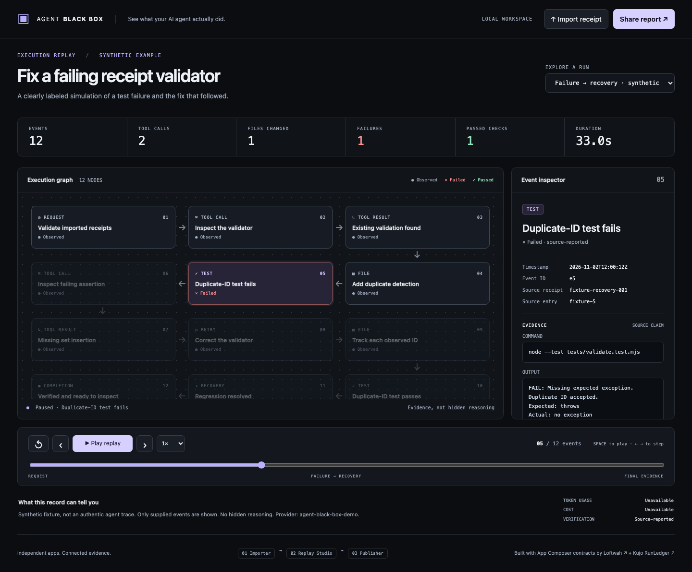

# Agent Black Box

**See what your AI agent actually did.**

An evidence-first execution replay: follow tool calls, inspect file changes, pause at a failure, and watch the recovery. Three independent Worker applications exchange versioned receipts using App Composer's real manifest and promotion contracts.



## Narrated walkthrough

[Watch the Siren / Eleven v4 walkthrough](videos/composer-siren/README.md): follow a bug from failure to fix, then see how App Composer connects the three apps. Includes a mobile 480p download, transcript, captions and verification evidence.

## Run locally

Node 22.13+ with `node:sqlite` (tested on Node 26.12.1), npm and Git:

```sh
npm ci
npm run dev
```

Open **http://127.0.0.1:4173**. The demo opens directly to the labeled failure/recovery example. Select **Kujo verification · recorded** for the genuine RunLedger receipt. Import a JSON receipt, inspect it, then choose **Share report** and explicitly approve the sanitized snapshot. A public report is read-only; “public” on localhost does not make it internet-accessible.

Private and public local stores live separately under ignored `.private/data/`. Restarting the server retains receipts, but rotates the local owner session. Reopen `/` for a fresh cookie.

## Verify

```sh
npx playwright install chromium
npm test
npm run build
npm run test:e2e
npm run compose:check
node scripts/compose.mjs --promote-local
```

`npm test` includes real workerd service bindings, separate D1 databases, and an executable Studio update that retains existing receipts. Browser tests exercise import → failure → recovery → explicit publication → anonymous public replay, keyboard controls, reduced motion, safe text, mobile layout, accessibility and 1,000-event windowing.

Independent builds: `npm run build --workspace @agent-black-box/replay-studio` (likewise `run-importer` and `receipt-publisher`). Each app produces its own Worker artifact and manifest under `dist/`. UI assets belong to Studio. No cloud credentials are needed for these commands.

## What is real

- Composer's upstream MIT validators are vendored unchanged and actually executed. Worker service bindings exchange data in workerd. App-owned D1 persistence survives an independent component update.
- The successful example comes from a real, isolated Kujo task recorded with RunLedger. Its command outputs are retained in `evidence/recorded-execution.json`; the receipt accurately discloses unavailable outputs and timing.
- The failure/recovery example is **synthetic**, labeled throughout. Token usage and cost are unavailable. Nothing exposes hidden reasoning or executes imported code.
- PackWrite compiled and validated the context pack through its documented **offline manifest seam**; no provider key was available. Loop ran the engineering gates and retained evidence.

## What is not claimed

This repository includes the source, recorded walkthrough and a runnable local demo. No hosted application endpoint is deployed. Composer's current native stack editor restricts apps to a reviewed list; these three new apps require an operator-reviewed catalogue/mount extension. This project uses a small explicit local adapter rather than claiming native registration, provisioning, or production promotion.

## Read more

- [Architecture and API boundaries](docs/ARCHITECTURE.md)
- [Source research and exact integration evidence](docs/RESEARCH.md)
- [Receipt schema and adapter rules](docs/SCHEMA.md)
- [Security and privacy](SECURITY.md)
- [Authorized deployment runbook](docs/DEPLOYMENT.md)
- [Verification and acceptance](docs/VERIFICATION.md)
- [Demo recording, article, social copy and maintainer feedback](docs/LAUNCH.md)
- [Final completion report](docs/COMPLETION.md)

MIT. Credit to **[Loftwah](https://github.com/loftwah)** and **[App Composer](https://composer.loftwah.com/)** for the independent-app architecture and reused contracts, and **[Kujo](https://github.com/kujolang)** for execution evidence and engineering workflows. See [THIRD_PARTY.md](THIRD_PARTY.md).
