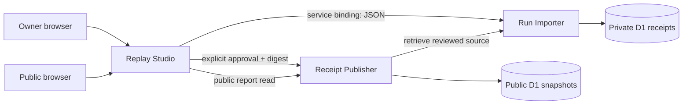

# Architecture and ownership

Agent Black Box is three independently versioned applications in a single source repository. Each directory has its own package, manifest, Wrangler profile and release artifact. The monorepo shares contract source intentionally; it does not pretend to be three separately owned Git histories. Each Worker can be rebuilt and promoted independently. Source publication does not deploy these Workers.

## Interfaces

| Owner | Endpoint | Contract |
| --- | --- | --- |
| Importer | `POST /api/runs` | Authenticated bounded JSON → normalized receipt, storage ID, SHA-256 digest, gaps, metrics |
| Importer | `GET /api/runs/:id` | Authenticated immutable receipt |
| Publisher | `POST /api/publish` | Authenticated `{receiptId,digest,approved:true}` → opaque public ID and `/reports/:id` |
| Publisher | `GET /api/public/:id` | Public approved snapshot, never a private-storage lookup |
| Publisher | `DELETE /api/public/:id` | Authenticated revocation |
| Each app | `GET /health` | Identity, component version and contract |
| Studio | `/`, `/reports/:id` | Browser replay; fixed Worker bindings proxy APIs |

All private calls require a host-selected owner token. The local Node server binds loopback, verifies Host, sets a random HttpOnly SameSite owner cookie on `/`, and uses the **same Worker fetch handlers**. It provides separate SQLite files as storage adapters. Hosted deployments do not accept this local cookie; users enter an operator-provided bearer token, kept only in JavaScript memory, into the importer. No imported field can supply authentication, URLs, SQL, commands or service configuration.

The actual workerd integration test uses Cloudflare service bindings and two D1 databases, creates a receipt and public snapshot, replaces only Studio executable bytes with version 1.0.1, then reads both unchanged. Node adapter tests alone are not presented as this proof.

## Composer's exact contribution

The unchanged MIT `validateManifest`, `validateComposition` and `guardPromotion` modules enforce namespace/route collisions, runtime/data compatibility, stale release rejection and capability expansion rules. `scripts/compose.mjs` wraps them with deterministic full-artifact digests. The Worker service-binding architecture follows the independently deployed Guestbook/Showcase reference model.

After building, `node scripts/compose.mjs --promote-local` writes a reviewed local composition lock. This is a local integration adapter, not Composer's native cloud promotion command. It does not mutate source, data, native catalogue records or cloud resources. Applications need a reviewed native mount/catalogue extension before they appear in Loftwah's stack editor. We do not use the production pair-specific CLI against arbitrary apps.

## Replay semantics

The ordered event array is authoritative. Timestamp sorting is forbidden. Playback advances one index per tick at selected speed; it never runs imported commands. Snaking rows connect consecutive observed events; retry targets are explicit in the inspector. A 60-node sliding window bounds DOM work for up to 1,000 events. Inspection pauses playback and selects the event at the same timeline index. Future events remain visible but dimmed.

RunLedger's separate commands/tests/file lists do not establish a total chronology. Its adapter preserves each list's order, groups those lists explicitly, uses null file timestamps, and discloses the limitation. It never pairs a test with a command merely because they occur nearby. Missing outputs stay missing. Source-reported pass states are not independent certification.

## Publication

Import performs heuristic redaction before storing anything. Publisher retrieves the private receipt through a fixed service binding, compares the approved digest, revalidates/redacts, and stores a distinct public snapshot. The public reader cannot access private records by ID. Revocation deletes that public snapshot; it cannot erase copies someone downloaded. No automatic publishing occurs on import, fixture selection or replay.

## Tradeoffs

Single trusted owner, not multi-tenant. No cloud accounts, deployments or automatic resource creation. No Watchdog/Dispatch/Workcell native import adapters yet. No private reasoning. Evidence URLs are shown as inert text; only fixed project attribution links navigate externally. JSON and Markdown/HTML content are rendered as text, so no HTML sanitizer parser is needed. Diff lines receive safe text-node highlighting. Costs and tokens are not part of canonical v1 and remain unavailable, even if a provider's native format contains additional accounting fields.
